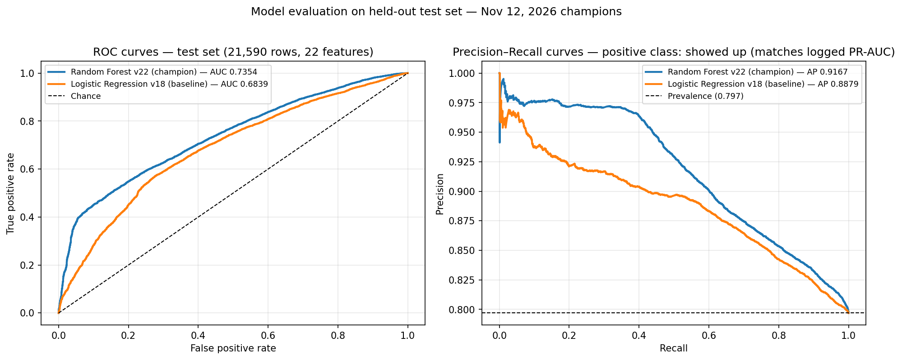
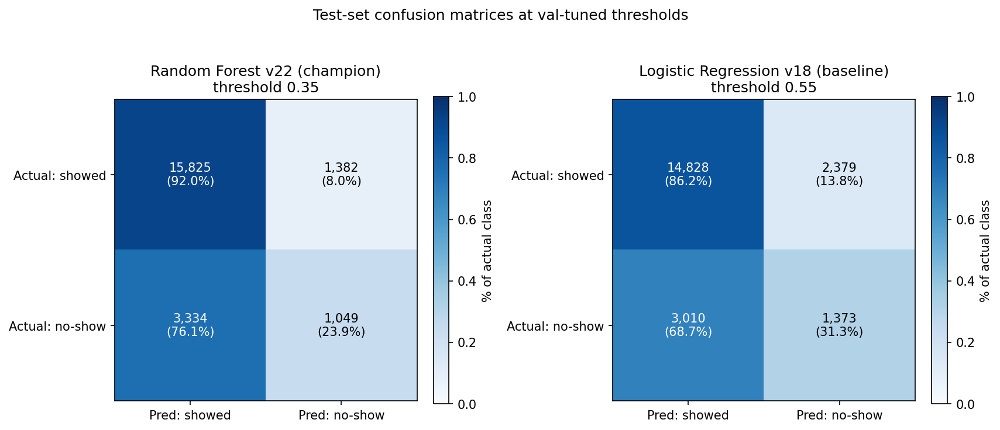
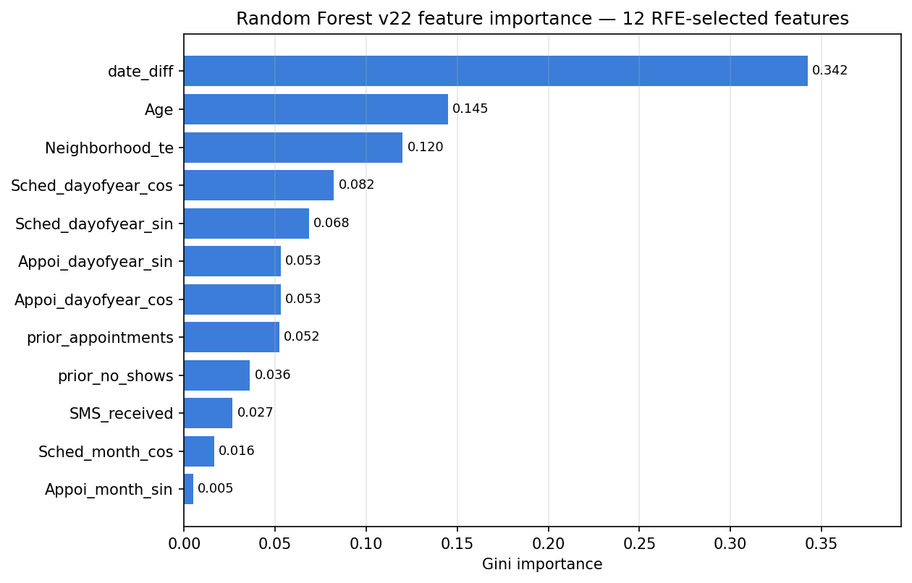
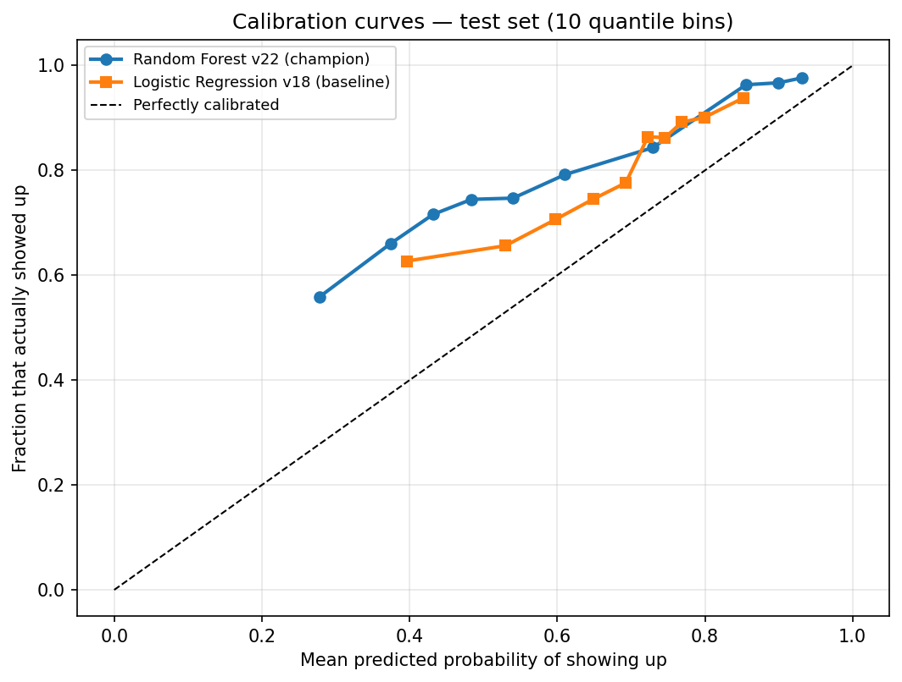

# No-Show Prediction

An end-to-end ML pipeline on Databricks that predicts whether patients will attend their scheduled medical appointments. The pipeline covers data loading, feature engineering, model training with hyperparameter tuning, MLflow experiment tracking, and automatic promotion of the best model to a production alias.

**Problem:** When patients miss appointments, clinics lose billable slots and waste clinical resources — predicting no-shows in advance lets staff overbook or send targeted reminders.

| Metric | Random Forest (Champion) | Logistic Regression (Baseline) |
|---|---|---|
| PR-AUC | 0.9167 | 0.8879 |
| No-show Recall | 0.2393 | 0.3133 |
| No-show Precision | 0.4315 | 0.3659 |
| F1 (weighted) | 0.7561 | 0.7430 |

PR-AUC measures how well the model ranks no-show risk across all thresholds, recall measures the fraction of actual no-shows caught, precision measures how many flagged patients truly miss, and F1 balances precision and recall.

---

## Dataset

**Source:** [Kaggle healthcare-no-shows-appointments-dataset](https://www.kaggle.com/datasets/iamtanmayshukla/healthcare-no-shows-appointments-dataset)

**Size:** ~107,000 rows of Brazilian healthcare appointment records  

**Target:** `Showed_up` — 1 if the patient attended, 0 if they did not

| Feature | Type | Description |
|---|---|---|
| `Gender` | Categorical | Patient gender |
| `Age` | Numeric | Patient age |
| `Neighborhood` | Categorical | Clinic neighbourhood (~81 distinct values) |
| `Scholarship` | Boolean | Enrolled in social welfare program |
| `Hypertension` | Boolean | Has hypertension |
| `Diabetes` | Boolean | Has diabetes |
| `Alcoholism` | Boolean | Has alcoholism |
| `Handicap` | Boolean | Has a handicap |
| `SMS_received` | Boolean | Received an SMS reminder |
| `ScheduledDay` | Date | Date appointment was booked |
| `AppointmentDay` | Date | Date of the appointment |

**Derived features:** `date_diff` = days between `ScheduledDay` and `AppointmentDay`, plus 4 point-in-time patient-history features (`prior_appointments`, `prior_no_shows`, `prior_no_show_ratio`, `has_history`) computed from `PatientId` on the bronze table using only strictly earlier appointment days (no future leakage)

`PatientId` and `AppointmentID` are dropped before training (`PatientId` lives only in bronze and is used solely to derive the history features).

---

## Pipeline

```
Dataset loaded from folder into bronze Delta table
        ↓
Load CSV into bronze Delta table
        ↓
Data Preprocessing
        * Schema validation with pre-defined expectations
        * Column renaming and casting to match expectations
        * Drop high-null columns, drop ID columns
        * Add unique ID for primary key
Feature Engineering
        * Compute date_diff (days between scheduling and appointment)
        * Compute point-in-time patient no-show history on bronze (4 features, pre-split)
        * Determine feature importance
        * 60/20/20 train/validation/test split (seed=42, performed before any encoder or scaler fitting)
        * Class imbalance handling (weightCol ≈ 4:1 for minority class)
        * Cyclical Date Encoding  →  sin/cos encoding for ScheduledDay & AppointmentDay (8 features: month + day-of-year sin/cos per date)
        * Encode Neighborhood as a numeric vector with TargetEncoder (~81 values)
        * Encode Gender similarly with StringIndexer + OneHotEncoder
        * Fit indexer, encoder, and scaler on the train split only
        * Scale train, validation, and test sets with MinMaxScaler
        * Apply class weights to handle imbalance (ratio of Maj to Min classes)
Model training
        * Select N most relevant features using Recursive Feature Elimination
        * (LR: 7 of 22 features, RF: 12 of 22 features)
Model training with CrossValidator (3-fold)
        * LR: AUC evaluator, RF: F1 (weighted) evaluator
        * Threshold tuned via F1 sweep post-training
Promote best version to @champion alias
```

### Feature engineering details

- **`date_diff`** — Days between scheduling and appointment date. Strong predictor — longer lead time correlates with higher no-show rate. Known at prediction time (no leakage).
- **Patient no-show history** — 4 point-in-time features (`prior_appointments`, `prior_no_shows`, `prior_no_show_ratio`, `has_history`) computed per patient on the bronze table with a window ordered by appointment day that counts only strictly earlier days — same-day appointments and future outcomes never leak. Cold-start patients (first appointment) get zeros with `has_history` = 0. Derived before the split, like the cyclical date features.
- **Cyclical date encoding** — month and day-of-year are each encoded as a sin/cos pair so the model sees the circular nature of calendar time (e.g. Dec 31 and Jan 1 are adjacent). Applied to both `ScheduledDay` and `AppointmentDay`, yielding 8 derived features.
- **Categorical encoding**:
  - `Neighborhood` (~81 values) → **TargetEncoder** (sklearn) — replaces each neighbourhood with its mean show-up rate on the training set (fit on `Showed_up`). Prevents OHE explosion and captures geographic patterns. Fit on training set only to avoid leakage.
  - `Gender` (2 values) → `StringIndexer` + `OneHotEncoder` (drop-last).
- **Numerical features (passed through as doubles):** `Age`, `Scholarship`, `Hypertension`, `Diabetes`, `Alcoholism`, `Handicap`, `SMS_received`, plus `date_diff`, the 4 patient-history features, and all 8 cyclical date features — 22 vector dimensions in total.
- Cyclical encoding is performed inline in the feature engineering module (`features/engineering.py`) using Spark column operations (`sin`, `cos`, `month`, `dayofyear`).

### Class imbalance handling

The dataset is 80% show / 20% no-show. To prevent the model from always predicting "show" and achieving misleading 80% accuracy:

- **`weightCol`** with weight for no-shows (minority class) derived from the training-set count ratio (show_count / no_show_count). For Logistic Regression this is ~1.98; for Random Forest ~4.0. Shows receive weight 1.0.
- **Primary metrics:** PR-AUC (Average Precision) for model comparison + F1 (weighted) + Recall on no-show class (healthcare sensitivity)
- Accuracy is NOT a primary metric due to imbalance

---

## Model Progression

The pipeline trains two models with the same train/test split, same features, and same `weightCol` for direct comparison:

| Model | Tuning Strategy | Hyperparameters | RFE Features | CV Evaluator | Threshold | Purpose |
|---|---|---|---|---|---|---|
| `LogisticRegression` | CrossValidator 3-fold, parallelism=6 | `elasticNetParam` ∈ {0, 0.5, 1.0}<br>`regParam` ∈ {0.001, 0.01, 0.05, 0.1, 0.5}<br>`maxIter` ∈ {100, 500, 1000} | 7 | AUC | 0.55 | Interpretable baseline |
| `RandomForestClassifier` | CrossValidator 3-fold, parallelism=4 | `numTrees` = 100<br>`maxDepth` ∈ {10, 12, 15}<br>`minInstancesPerNode` ∈ {5, 20}<br>`featureSubsetStrategy` ∈ {sqrt, log2} | 12 | F1 (weighted) | 0.35 | Champion model |

**Selection metric:** PR-AUC (Average Precision) — chosen over ROC-AUC for sensitivity to class imbalance  
**Random seed:** 42 for reproducibility

### Results

All figures below are from the Nov 12, 2026 pipeline retrain on the 22-feature dataset (patient-history features added). Random Forest registered `noshows_random_forest` **v22** (@champion) and Logistic Regression registered `noshows_logistic_regression` **v18** (@champion); both runs logged full params and metrics to MLflow. Thresholds (RF 0.35, LR 0.55) were tuned on the validation set, not test. LR now trains on the full 64,176-row training set — the earlier 48k-row randomSplit carve-out produced a degenerate always-predicts-show model (no-show F1 0.0036), fixed in v18.

| Metric | Random Forest (Champion) | Logistic Regression (Baseline) |
|---|---|---|
| PR-AUC | 0.9167 | 0.8879 |
| F1 (weighted) | 0.7561 | 0.7430 |
| Best Threshold | 0.35 | 0.55 |
| No-show Recall (Class 0) | 0.2393 | 0.3133 |
| No-show Precision (Class 0) | 0.4315 | 0.3659 |
| No-show F1 (Class 0) | 0.3079 | 0.3376 |

The Random Forest outperforms the Logistic Regression baseline on PR-AUC (+0.0288) and weighted F1 (+0.0131). At the F1-optimal threshold the RF model catches ~24% of actual no-shows (recall 0.2393, precision 0.4315, no-show F1 0.3079) — non-linear feature interactions buy ranking quality (PR-AUC), while a lower decision threshold can trade precision for more caught no-shows. The patient-history features carry signal: RFE kept `prior_appointments` and `prior_no_shows` for both models. Other test metrics: ROC-AUC 0.7354, accuracy 0.7816. Test confusion matrix at threshold 0.35 (rows = actual Showed_up 1 / 0, columns = predicted 1 / 0): 15,825 / 1,382 / 3,334 / 1,049. LR v18 test confusion matrix at threshold 0.55: 14,828 / 2,379 / 3,010 / 1,373 (best params: maxIter 100, regParam 0.001).

### Evaluation Plots

**ROC and Precision-Recall Curves** — both models compared against baselines. The RF model's higher PR-AUC (0.9167 vs 0.8879) reflects better ranking of no-show risk across all thresholds. PR curves are computed with showed-up (label 1) as the positive class, matching how the logged PR-AUC metric is calculated.



**Confusion Matrices** — classification results at each model's tuned threshold (RF: 0.35, LR: 0.55).



**Random Forest Feature Importance** — Gini importance of the 12 RFE-selected features. `date_diff` dominates (0.342), followed by `Age` (0.145) and `Neighborhood_te` (0.120); the patient-history features (`prior_appointments` + `prior_no_shows`) together carry ~0.09 — confirming that lead time and patient history are the strongest no-show predictors.



**Calibration Curves** — predicted vs actual show-up rates. Both models are well-calibrated in the mid-range; deviations at the extremes reflect the class imbalance.



*GBTClassifier is planned as a future model in the progression.*

---

## MLflow & Model Registry

- **Experiment:** path defined in `config.yaml` (`mlflow.experiment_path`)
- **Registered models:** defined in `config.yaml` — `rf_model_path` (champion) and `lr_model_path` (baseline)
- Each run logs:
  - **Parameters:** All model hyperparameters and pipeline config
  - **Metrics:** PR-AUC, F1 (weighted), precision, recall, AUC
  - **Artifacts:** `feature_schema.json` for schema validation
  - **Tags:** `run_id`, `dataset`, `validated_by` metadata
- The best version from each training run is promoted to the `@champion` alias.

**Load the champion model for inference:**

```python
import yaml
import mlflow.spark

with open("config.yaml") as f:
    cfg = yaml.safe_load(f)

# Random Forest (champion)
model = mlflow.spark.load_model(f"models:/{cfg['rf_model_path']}@champion")
predictions = model.transform(new_data_df)

# Logistic Regression (baseline)
lr_model = mlflow.spark.load_model(f"models:/{cfg['lr_model_path']}@champion")
```
---

## Files

```
no_show_prediction/
├── config.yaml                   # All paths and settings — see Configuration below
├── data/
│   ├── loader.py / preprocessor.py / schemas.py  # Data loading & preprocessing modules
│   ├── input-datasets/
│   │   ├── healthcare_noshows.csv       # Raw dataset (~107K rows), uploaded to volume_path
│   │   └── Upload CSV to UC Volume      # Notebook that loads the CSV into volume_path
├── features/
│   └── engineering.py            # Feature engineering module (RFE, encoding, scaling)
├── models/
│   ├── logistic_regression/      # LR training notebook (ID: 1606283588053603)
│   └── random_forest/             # RF training notebook (ID: 1606283588053604)
├── tests/                        # Pytest suite (test_engineering.py, test_preprocessor.py)
└── docs/
    ├── README.md                 # This file
    ├── design.md                  # Business context, metric choice, cost asymmetry
    ├── HANDOFF.md                  # Project state, pending work, gotchas — start here for onboarding
    ├── model_card_random_forest.md    # RF model card
    ├── model_card_logistic_regression.md  # LR model card
    └── requirements.txt           # Dependencies not pre-installed on Databricks
```

**All dataset, table, and model locations are defined in `config.yaml`** — see [Configuration](#configuration-configyaml).

---

## Configuration (`config.yaml`)

All workspace-specific paths live in `config.yaml` at the project root. Every notebook and module reads its dataset, table, and model locations from this file, so no absolute paths are hardcoded in the code. Create the file before running anything:

```yaml
# Unity Catalog volume that holds the raw dataset
volume_path: "/Volumes/<catalog>/<schema>/<volume>"

# Raw CSV (uploaded to the volume above via the "Upload CSV to UC Volume" notebook)
dataset_path: "/Volumes/<catalog>/<schema>/<volume>/healthcare_noshows.csv"

# Tables
bronze_table_path: "<catalog>.<schema>.<bronze_table>"
silver_table_path: "<catalog>.<schema>.<silver_table>"

# Scaled datasets
train_scaled_dataset_path: "<catalog>.<schema>.<train_scaled_table>"
test_scaled_dataset_path: "<catalog>.<schema>.<test_scaled_table>"

# Registered models (Unity Catalog Model Registry)
lr_model_path: "<catalog>.<schema>.<logistic_regression_model>"
rf_model_path: "<catalog>.<schema>.<random_forest_model>"

# Absolute workspace path to the features module (imported by the training notebooks)
features_path: "/Workspace/Users/<your-username>/no_show_prediction/features"

mlflow:
  experiment_path: "/Users/<your-username>/<experiment-name>"

model_output_path: "<catalog>.<schema>.<models>"

random_seed: 42
```

Notes:
- Replace `<your-username>` with your Databricks workspace username, and `<catalog>.<schema>` with the Unity Catalog names the pipeline should write to.
- `config.yaml` is gitignored — each user creates their own copy, which is why no workspace path appears in committed code.
- If you move the project, only `features_path` and `mlflow.experiment_path` need updating; every other key points at Unity Catalog objects.

---

## Running the pipeline

### Prerequisites

**1. Create `config.yaml`** at the project root — copy the template in [Configuration](#configuration-configyaml) and fill in your Unity Catalog names and workspace username.

**2. Install dependencies** (only needed for notebooks, not for jobs with proper cluster config):

```python
%pip install -r requirements.txt
```

Required packages:
- `scikit-learn>=1.3.0` (for TargetEncoder)
- `pandas>=2.0.0` (data manipulation)

*Note: PySpark, MLflow, NumPy, and Matplotlib are pre-installed on Databricks.*

### Execution

1. **Model training:** Run the `models/logistic_regression` and `models/random_forest` notebooks in the Databricks notebook UI
   - Each notebook loads data via `config.yaml`, runs feature engineering from `features/engineering.py`, trains with CrossValidator, and logs to MLflow
2. **Feature engineering:** The `features/engineering.py` module is imported by both model notebooks via `config.yaml`'s `features_path` key

**To schedule retraining:** Create a Databricks Job pointing to a model training notebook and set a cron trigger (e.g. weekly).


<!--
---

## Project Status

**Completed:**
* ✅ Cyclical date encoding (sin/cos for month + day-of-year on both date columns)
* ✅ TargetEncoder for high-cardinality categorical features (Neighborhood)
* ✅ Class imbalance handling with `weightCol`
* ✅ Recursive Feature Elimination (7 features for LR, 12 for RF)
* ✅ CrossValidator hyperparameter tuning (LR: 45-param grid, RF: sparse grid)
* ✅ Threshold optimization via F1 sweep (LR: 0.55, RF: 0.30)
* ✅ PR-AUC (Average Precision) as primary model comparison metric
* ✅ MLflow experiment tracking and artifact logging
* ✅ Model Registry integration with `@champion` alias promotion
* ✅ Model cards for both Random Forest and Logistic Regression

**Potential enhancements:**
* GBTClassifier as the next model in the progression
* Model interpretation (SHAP values, feature importance)
* Deployment as a Model Serving endpoint
* A/B testing framework for model comparison
* Fairness audit across protected attributes (age, gender, neighbourhood)
-->

